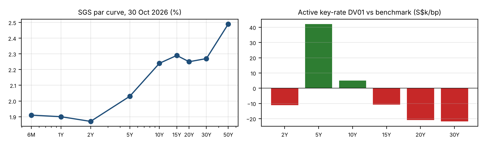

<!-- Generated by `make analysis` from report/templates/README.md.j2. Edit the template, not this file. -->
# SGD Fixed Income Model Portfolio vs Benchmark

*An SGD government and investment-grade bond portfolio positioned against an SGS 2Y–30Y benchmark, with key-rate risk, ex-ante tracking error and six-month scenario attribution, built from MAS benchmark yields as at 30 Oct 2026.*

## Summary

- **Duration underweight, -0.35 yrs** (5.53 vs 5.88; -17.4 S\$k/bp on S\$500m), held as a hedge for the long-end view rather than a call on direction. The Fed hiked in September, held on 28 October and is guiding higher, and SGS moved about 0.66× UST in October; duration P&L is roughly symmetric (-14 bp bull, +18 bp bear), so it is kept small.
- **Curve: DV01-matched 5s30s steepener**, long the 5Y belly against short 20Y–30Y (active KRD 5Y +0.84, 20Y -0.42, 30Y -0.44); entry +24 bp, target +44 bp, stop +14 bp. MAS's appreciating S\$NEER slope anchors the front end, while 10s30s at +3 bp pays no term premium for long-end risk.
- **SGD IG credit overweight, 33% of market value** (spread duration 1.79 yrs), mostly AAA statutory boards and AA- bank seniors at 4.5–10Y: with a flat curve, spread is the main source of carry. Statutory-board spreads are calibrated to HDB's September 4Y print; hard stop on +25 bp SGD IG widening.
- **+24 bp yield pick-up for 77 bp ex-ante tracking error** against a 100 bp budget (54 bp over 6M); over six months the pick-up absorbs about 7 bp of spread widening.
- **Six-month active return:** base **+32 bp**, bear **+23 bp**, bull **+12 bp**, credit stress **-104 bp**. Credit stress is the main risk, and corporate/REIT lines are cut first.

## Report

- **[Model portfolio positioning note, October 2026 (PDF, 2 pages)](report/portfolio_commentary.pdf)** · [Markdown version](report/portfolio_commentary.md)
- Full tables: [trade levels](output/levels.md) · [risk vs benchmark](output/risk.md) · [key-rate durations](output/krd.md) · [holdings](output/holdings.md) · [scenarios](output/scenarios.md) · [return attribution](output/attribution.md) · [all results (JSON)](output/results.json)



## Method

**Curve.** SGS par yields are linearly interpolated onto a semi-annual grid. Discount factors are bootstrapped from par bonds:

$$DF_n=\frac{1-\tfrac{c_n}{2}\sum_{i<n}DF_i}{1+\tfrac{c_n}{2}},\qquad z(t)=2\left(DF(t)^{-1/(2t)}-1\right)$$

**Pricing.** Each bond is priced off the zero curve plus a constant z-spread $s$. Prices are dirty unless stated otherwise:

$$P=\sum_i CF_i\left(1+\frac{z(t_i)+s}{2}\right)^{-2t_i}$$

**Risk.** All measures are effective, computed by central-difference revaluation with $\Delta y=1$ bp. Shocks are applied to the par curve, which is then re-bootstrapped.

$$D=\frac{P_{-}-P_{+}}{2P_0\,\Delta y},\quad \mathrm{DV01}=D\cdot MV\cdot10^{-4},\quad KRD_k=\frac{P(-\delta_k)-P(+\delta_k)}{2P_0\,\Delta y},\quad \sum_k KRD_k=D$$

Here $\delta_k$ is a triangular 1 bp bump centred on key tenor $k\in\{2,5,10,15,20,30\}$, held flat beyond the end keys. Spread duration $SD$ uses the same formula with $s$ bumped instead of the curve.

**Conventions.** Yields, zeros and z-spreads are semi-annual bond-equivalent, with coupons paid semi-annually and cash flows on an exact half-year grid back-stepped from maturity (no day count or holiday calendar). DV01 is reported as a positive number for a long-duration position: it is the S\$ loss for a 1 bp parallel rise in par yields. Portfolio yield is the market-value-weighted average of bond yields to maturity.

**Benchmark weights.** Weights are set so that each line contributes equal duration:

$$w_i=\frac{1/D_i}{\sum_j 1/D_j}$$

**Tracking error.** Let $x$ be the active exposures (6 key-rate durations and 3 sector spread durations) and $\Sigma$ the annualised factor covariance:

$$TE=\sqrt{x^\top\Sigma\,x+\sum_{i\in\text{credit}}\left(w_i\,SD_i\,\sigma^{\text{idio}}_i\right)^2},\qquad \Sigma_{ij}=\sigma_i\sigma_j\rho_{ij},\quad \rho^{\text{rates}}_{ij}=e^{-\lambda|T_i-T_j|}$$

**Return attribution** over horizon $h$:

$$R_h=\underbrace{y\,h}_{\text{carry}}+\underbrace{\left(R^{\text{static}}_h-y\,h\right)}_{\text{roll-down}}\;\underbrace{-\tilde D\,\overline{\Delta y}}_{\text{duration}}\;\underbrace{-\sum_k \widetilde{KRD}_k\left(\Delta y_k-\overline{\Delta y}\right)}_{\text{curve}}\;\underbrace{-\widetilde{SD}\,\Delta s}_{\text{spread}}\;+\;\varepsilon$$

- $y$ is yield to maturity.
- $R^{\text{static}}_h$ is the full-revaluation return on an unchanged curve.
- $\overline{\Delta y}$ is the mean of the six key-rate shocks.
- Tildes mark risk measured on the bond aged to $h$, scaled by $P_h/P_0$.
- $\varepsilon$ is full revaluation minus the linear terms (convexity and cross terms).

Active return is $R^A=\sum_i w^P_iR_i-\sum_j w^B_jR_j$.

**Data and sources.**

| Input | Value used | Source | As of |
|---|---|---|---|
| SGS benchmark yields, 6M–50Y | [data/sgs_benchmark_yields.csv](data/sgs_benchmark_yields.csv) | [MAS, SGS Prices and Yields – benchmark issues](https://eservices.mas.gov.sg/statistics/fdanet/BenchmarkPricesAndYields.aspx) (average buying rates of government securities dealers) | 30 Oct 2026 |
| UST 10Y yield | 4.94% (5.29% on 30 Sep) | [FRED, DGS10](https://fred.stlouisfed.org/series/DGS10) | 30 Oct 2026 |
| SGS 10Y yield, prior month-end | 2.47% | [MAS, SGS Prices and Yields – benchmark issues](https://eservices.mas.gov.sg/statistics/fdanet/BenchmarkPricesAndYields.aspx) | 30 Sep 2026 |
| Fed funds target range | 3.75–4.00%: +25 bp on 16 Sep, unchanged on 28 Oct | FOMC statements, [16 Sep](https://www.federalreserve.gov/newsevents/pressreleases/monetary20260916a.htm) and [28 Oct](https://www.federalreserve.gov/newsevents/pressreleases/monetary20261028a.htm) | 28 Oct 2026 |
| MAS policy | Slope raised slightly (14 Apr) and very slightly (27 Jul); unchanged on 14 Oct | [MAS, past monetary policy decisions](https://www.mas.gov.sg/monetary-policy/past-monetary-policy-decisions) | 14 Oct 2026 |
| S\$NEER slope | ~1.25% p.a. | Market estimate (UOB); MAS does not publish the slope | 14 Oct 2026 |
| HDB 3.46% 21-May-2031 | Coupon and maturity | HDB press release "HDB Issues Rated Fixed Rate Notes" (3.460% semi-annual, issued 21 May 2024, due 21 May 2031; no longer online); issue size and 2031 maturity also in [Allen & Gledhill deal note](https://www.allenandgledhill.com/sg/perspectives/articles/28127/issue-of-s-900-million-fixed-rate-notes-by-housing-and-development-board) | 21 May 2024 |
| SGD and Asia credit backdrop | Qualitative | [OCBC Monthly Credit View, October 2026](https://www.ocbc.com/iwov-resources/sg/ocbc/gbc/pdf/Credit%20Research/Monthly%20Reports/2026/OCBC%20Asia%20Credit%20Monthly%20Credit%20View%20-%20Public%20(October%202026).pdf) | 6 Oct 2026 (data to 30 Sep) |
| HDB 4Y green new issue | 2.586% (35–69 bp over SGS 4Y across September) | [OCBC Monthly Credit View, October 2026](https://www.ocbc.com/iwov-resources/sg/ocbc/gbc/pdf/Credit%20Research/Monthly%20Reports/2026/OCBC%20Asia%20Credit%20Monthly%20Credit%20View%20-%20Public%20(October%202026).pdf), "Key SGD issues in September 2026"; SGS from MAS | Sep 2026 |
| Statutory-board spreads | 40 bp (HDB 4.6Y), 47 bp (10Y) | Calibrated to the HDB 4Y print above | 30 Oct 2026 |
| Bank, GLC and REIT spreads | 55–125 bp by line | Illustrative assumption (see Limitations) | 30 Oct 2026 |
| Factor vols and correlations | See `src/sgdfi/market.py` | Assumption, not fitted to history | – |

**Assumptions.**

- **Benchmark weighting: duration-weighted** (equal rate risk per tenor, in the spirit of a liability-style benchmark) rather than market-value weighted, so that no single tenor dominates rate risk and the benchmark does not depend on line-by-line SGS outstanding amounts.
- Benchmark lines are **par bonds** at the MAS benchmark yields (coupon = yield), not the actual SGS coupons and maturities.
- Fund size of **S\$500m**, used only to express DV01 in S\$.
- Tracking-error budget of **100 bp p.a.**
- Rate vols of 55–72 bp p.a. by tenor, decay $\lambda$ = 0.03. Sector spread vols of 10/30/45 bp, issuer-specific vols of 5/15/30 bp, spread–spread correlation 0.7 and spread–rate correlation −0.2.
- The scenario horizon is **6 months**. Coupons are received but not reinvested, and curve shocks are judgmental (see `src/sgdfi/scenarios.py`).
- HDB 2031 maturity is approximated as 4.56 years from 30 Oct 2026.
- Coupons on illustrative credit bonds are set so each prices near par at its spread, rounded to 1/80%.

## How to reproduce

Requires Python 3.10+.

```bash
git clone https://github.com/HuwaWei/sgd-fixed-income-portfolio.git
cd sgd-fixed-income-portfolio
python -m venv .venv && source .venv/bin/activate
pip install -r requirements.txt
make test analysis
```

`make test` runs the unit tests. `make analysis` (equivalently `PYTHONPATH=src python -m sgdfi`) reads `data/`, rebuilds `output/*.md`, `output/results.json`, the figure, the commentary and this README. `make pdf` renders the 2-page PDF and additionally needs `pandoc` and Node with Playwright/Chromium; `make all` runs install, tests, analysis and PDF in one step.

## Limitations

- **Single-date snapshot.** All analytics are as at 30 Oct 2026. Attribution is ex-ante (scenario-based), not a realised performance record.
- **Credit spreads are mostly illustrative.** There is no public SGD IG spread curve for 30 Oct 2026. Statutory-board spreads rest on a single comparable (HDB's September 4Y print, whose implied spread ranged 35–69 bp as SGS moved); at the prior 18/25 bp the pick-up is +22 bp, and at the top of the range +27 bp. Bank, GLC and REIT spreads (55–125 bp) are assumptions, and those lines are generic proxies, not specific issues. There is no liquidity, bid/offer or new-issue concession modelling, and spreads are constant across tenor.
- **S\$NEER slope.** MAS does not publish the slope; ~1.25% p.a. is a market estimate.
- **No market history.** Tracking error and scenarios depend on assumed vols and judgmental shocks, not on an empirical covariance matrix or SGS/SORA history.
- **Benchmark is a model construct**, not a published index (e.g. FTSE/iBoxx). The duration weighting makes it front-end heavy by market value (about half in 2Y) and shorter than a market-value-weighted SGS index, so active positions are measured against equal risk per tenor.
- **Simplified conventions.** Cash flows sit on an exact half-year grid with no day count or holiday calendar, and the 6M and 1Y T-bill yields are treated as semi-annual par yields.
- There are no transaction costs, repo/funding, FX hedging or SORA/IRS overlays. In practice the curve trade could be run more efficiently in SGD IRS.

---

Huwa Jia Wei, NUS Economics & Statistics · [MIT License](LICENSE)
