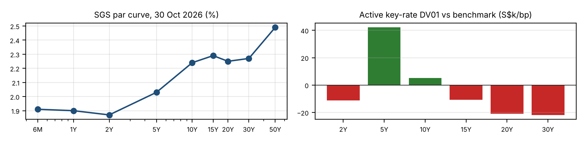
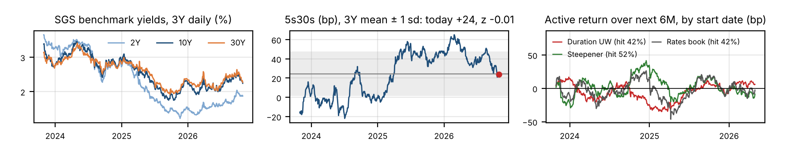

# SGD Fixed Income Model Portfolio vs Benchmark

**Model portfolio positioning note, October 2026** · Huwa Jia Wei · Data as at 30 Oct 2026 · Benchmark: SGS 2Y–30Y, duration-weighted (equal rate risk per tenor)

> **Positioning in one line:** a modest duration underweight (**-0.35 yrs**), taken mainly in the 2Y and 15Y key rates. The SGS 5Y belly is overweight against short 20Y–30Y, and a **33%** SGD investment-grade credit sleeve is funded mainly out of 2Y SGS. Yield pick-up is **+24 bp**. Ex-ante tracking error is **77 bp** against a 100 bp budget.

## Market view

**SGS trade well through Treasuries, but the long end still carries global beta.** The Fed hiked 25 bp to 3.75–4.00% on 16 September, its first hike since 2023, and the dots point to one more this year. It held on 28 October (10–2 vote), with a December hike priced. The 10Y UST closed at 4.94% on 30 October[^1], which puts the 10Y SGS 270 bp below Treasuries. SGS do follow UST, at lower beta: in October the 10Y SGS fell 23 bp (2.47% to 2.24%) as UST fell 35 bp, a beta of about 0.66. The level gap is mostly explained by policy. MAS raised the S\$NEER slope slightly in April and very slightly in July, then held on 14 October; the slope is estimated at about 1.25% a year. Under uncovered interest parity, expected S\$ appreciation holds SGD rates below USD; covered interest parity then shows up as negative USD/SGD forward points. The slope alone does not explain the full front-end gap: 6M SGS sit 184–209 bp below the Fed funds range, against a ~1.25% expected appreciation. The remainder reflects an S\$ risk premium, the USD/SGD FX-swap basis, and structural demand for SGS from banks' liquid-asset requirements. Our view is that the policy band keeps the front end anchored but cannot protect the long end.

**The curve offers almost no term premium.** 2s10s is +37 bp and 10s30s is +3 bp. The 15Y (2.29%) yields more than the 20Y (2.25%), and 6M (1.91%) yields more than 2Y (1.87%). Holding the long end therefore pays nothing extra for duration risk, while a sell-off in global term premium would flow into it. The 2Y–5Y segment, at +16 bp over three years, is the steepest part of the curve per unit of duration and gives the best roll-down.

**Credit is where the carry is.** With a flat government curve, extending duration earns very little, so spread is the main source of carry. SGD supply was muted in September (S\$2.3bn against S\$5.6bn in August), which OCBC notes supported spreads. OCBC's October credit view (data to 30 September) describes recent weakness as concentrated in lower-quality high yield rather than in IG[^2]. HDB priced a 4Y green bond at 2.586% in September, 35–69 bp over SGS depending on the day; statutory-board spreads here are set at 40/47 bp (4.6Y/10Y). At the prior 18/25 bp the pick-up would be +22 bp, and at the top of the range +27 bp.

## Positioning and rationale

| Position | Size | Conviction | Rationale |
|------|--------|---|---------------|
| Duration underweight | -0.35 yrs, -17.4 S\$k/bp | Low (was Medium) | A hedge for the long-end view, not a source of return. With the Fed still hiking, a rise in global term premium would hit the SGS long end. Duration P&L is roughly symmetric (-14 bp bull, +18 bp bear), so it is kept small. History does not support it as a return source |
| Curve: long 5Y, short 20Y–30Y | 5Y KRD +0.84; 20Y+30Y -0.85 | Medium (was High) | Captures 2s5s slope and roll-down; avoids a long end (10s30s +3 bp) exposed to UST term premium. 5s30s is at its 3-year mean, not stretched |
| SGD IG credit overweight | 33% MV, spread duration 1.79 yrs, avg 69 bp | Medium | Carry in a flat curve. Kept at 4.5–10Y and mostly AA-/AAA: statutory boards 0.60, banks 0.47, corporates/REIT 0.73 yrs of spread duration |

The credit sleeve is mostly funded from the 2Y SGS, which yields below 6M bills and contributes little carry. The 2Y underweight (-0.22 KRD) is a funding leg, not a rates view.

## Risk vs benchmark

| Metric | Model | Benchmark | Active |
|---|---:|---:|---:|
| Effective duration, yrs | 5.53 | 5.88 | -0.35 |
| Yield to maturity (MV-weighted), % | 2.26 | 2.02 | +0.24 |
| DV01, S\$k per bp (S\$500m; + = long) | 276.4 | 293.8 | -17.4 |
| Spread duration, yrs | 1.79 | 0.00 | +1.79 |
| Credit weight, % | 33.0 | 0.0 | +33.0 |
| Avg spread over SGS, bp | 23 | 0 | +23 |
| Effective convexity, yrs² | 58.8 | 76.6 | -17.8 |
| Ex-ante tracking error, bp p.a. | 77 | – | – |

Rates and spread contribute about equally to the risk budget: 52 bp of TE from rates alone and 52 bp from spread alone, including 18 bp of issuer-specific risk. The rates/spread cross-term adds risk rather than diversifying it: with spreads assumed to widen when SGS rally, the short duration and long credit both lose in risk-off, so total TE (77 bp) exceeds the 73 bp it would be if the two were uncorrelated. Over the 6-month horizon used throughout, TE is 54 bp, and the yield pick-up is lost if spreads widen by about **7 bp**; that is our credit break-even.

## Six-month scenarios

| Scenario (6M) | Narrative | SGS 2Y / 10Y / 30Y, bp | Spreads Stat board / Bank / Corp-REIT, bp | Model % | Bench % | Active bp |
|----|------------------|------|------|---:|---:|---:|
| **Bull** | Fed pauses after one hike; UST 10Y back to ~4.4%; SGS bull-flattens | -30 / -45 / -45 | -3 / -10 / -15 | +3.47 | +3.35 | +12 |
| **Base** | Central view: MAS anchors front end, global term premium lifts SGS long end | -5 / +10 / +20 | +0 / +0 / +0 | +0.81 | +0.49 | +32 |
| **Bear** | Two more Fed hikes; UST 10Y ~5.5%; SGS bear-steepens | +25 / +55 / +70 | +5 / +15 / +25 | -1.47 | -1.70 | +23 |
| **Credit stress** | Risk-off: flight to SGS quality, Asian credit reprices | -25 / -30 / -25 | +15 / +60 / +120 | +1.44 | +2.48 | -104 |

Active return breakdown, bp: carry/roll **+14** in every scenario. Curve contributes **+15** in the base case and **+21** in the bear case. Spread contributes **-115** in credit stress. The portfolio is built to outperform in base and bear. It also stays ahead in a bull rally (+12 bp), because spread tightening offsets the duration underweight. **Credit stress is the main risk: -104 bp** over six months, about 1.9× six-month TE (54 bp). We keep the size because 61% of the sleeve is AAA or AA-, and run a hard stop instead: corporate/REIT lines, which drive most of the stress loss, are cut if SGD IG spreads widen 25 bp.

## Trade levels

| Trade | Size | Entry | Target (6M) | Stop |
|---|---|---|---|---|
| **5s30s steepener**: long 5Y vs short 20Y–30Y | +42.1 / -42.7 S\$k/bp (DV01-matched) | +24 bp | +44 bp (base case) | +14 bp |
| **Duration underweight** | -17.4 S\$k/bp | SGS 10Y 2.24% | 2.34% (base case) | UST 10Y close < 4.50% |
| **SGD IG credit overweight** | 33% MV, SD 1.79 yrs | avg 69 bp | spread carry +11 bp, spreads unchanged | SGD IG +25 bp, or HY stress reaching BB/IG: cut corp/REIT first |

The steepener's legs are DV01-matched, so its P&L is curve shape, not direction; the net duration underweight sits in the 2Y and 15Y key rates. Curve target is the base-case move; the stop is set for 2:1 reward/risk.

## Does history support the positioning?

| 6M holding, active bp | Today vs 3Y mean ± sd | Hit rate | Avg | Worst 6M | Max DD | Starts like today: hit / avg | History |
|------------|-------------------------|-----:|----:|-----:|----:|--------:|--------|
| Duration underweight | 10Y 2.24% vs 2.53 ± 0.45% (z -0.66) | 42% | -5.5 | -35 | -35 | 72% / +3.9 | Weakens |
| 5s30s steepener | 5s30s +24 vs +24 ± 23 bp (z -0.01) | 52% | +2.6 | -29 | -32 | 65% / +5.9 | Mild support |
| Rates book | All rates exposures together | 42% | -2.4 | -46 | -49 | 61% / +4.1 | Weakens |

**Only partly.**[^3] *Duration:* history weakens the call. SGS rallied through most of the window, so a similar underweight lost 5.5 bp per six months on average; it paid only from yields as low as today's, all in one episode (Jun 2025–Apr 2026). We keep it as a small hedge, with conviction cut to Low. *Curve:* mild support. 5s30s sits at its 3-year mean and is flat only against the past year (+44 bp). The +20 bp target was reached in 28% of windows and the stop in 25%, so conviction is cut to Medium. *Rates book:* no edge on its own (-2.4 bp), so the excess return relies on credit carry, which public data cannot test. Realised rate vols (52–63 bp) are at or below the TE assumptions. Position sizes are unchanged.

## Outlook and what would change our mind

- **Cover the duration underweight** if the 10Y UST closes below 4.5% or the Fed signals a stop, since the spillover thesis then fades.
- **Add to the 5s30s steepener** if MAS steepens the slope at its January 2027 review. A stronger S\$NEER would anchor the front end further.
- **Cut corporate/REIT credit first (hard stop)** if SGD IG spreads widen by more than 25 bp, or if spread widening extends beyond weaker high yield into BB and IG (OCBC's own caution trigger). Statutory boards stay as liquid reserves.

[^1]: UST 10Y: FRED DGS10 close, 30 Oct 2026. MAS decisions: MAS past monetary policy decisions table; MAS does not publish the slope, so ~1.25% is a market estimate (UOB). Fed decisions: FOMC statements, 16 Sep and 28 Oct 2026. SGS yields: MAS benchmark closing yields (average buying rates of government securities dealers), 30 Oct 2026.
[^2]: OCBC Monthly Credit View, 6 Oct 2026. There is no public SGD IG spread curve as at 30 Oct 2026. Statutory-board spreads are calibrated to HDB's September 4Y print (OCBC; SGS from MAS); bank, GLC and REIT spreads are **illustrative** assumptions. HDB 3.46% 21-May-2031 coupon and maturity are from HDB's May-2024 pricing release. SGS 10Y on 30 Sep: MAS; UST 10Y on 30 Sep: FRED. These are model-portfolio analytics, not investment advice.
[^3]: MAS, SGS Prices and Yields – benchmark issues, daily, 2023-10-30 to 2026-10-30 (746 days; days with a missing tenor dropped). Positions are rebuilt daily at today's sizing, held 6M and revalued in full, with carry; the rates book treats credit lines as same-maturity SGS. Windows overlap (about five independent 6M periods), so results are indicative. "Like today": 10Y (or 5s30s) at or below today's level.
